# Auxetic Lattice Cores for a Morphing Wing (Eppler 420)

**Advancing morphing aircraft wings: performance optimisation using auxetic structures**

Research proposal and progress record &nbsp;·&nbsp; **Stage 1 (design) complete** &nbsp;·&nbsp; Stage 2 (simulation) starting

**Zahin Tasnim Ridita** &nbsp;·&nbsp; B.Sc. Industrial and Production Engineering, Islamic University of Technology (IUT), Bangladesh

<!-- Replace the images in images/ with screenshots of your own SolidWorks models (keep the same file names). -->
<p align="center">
  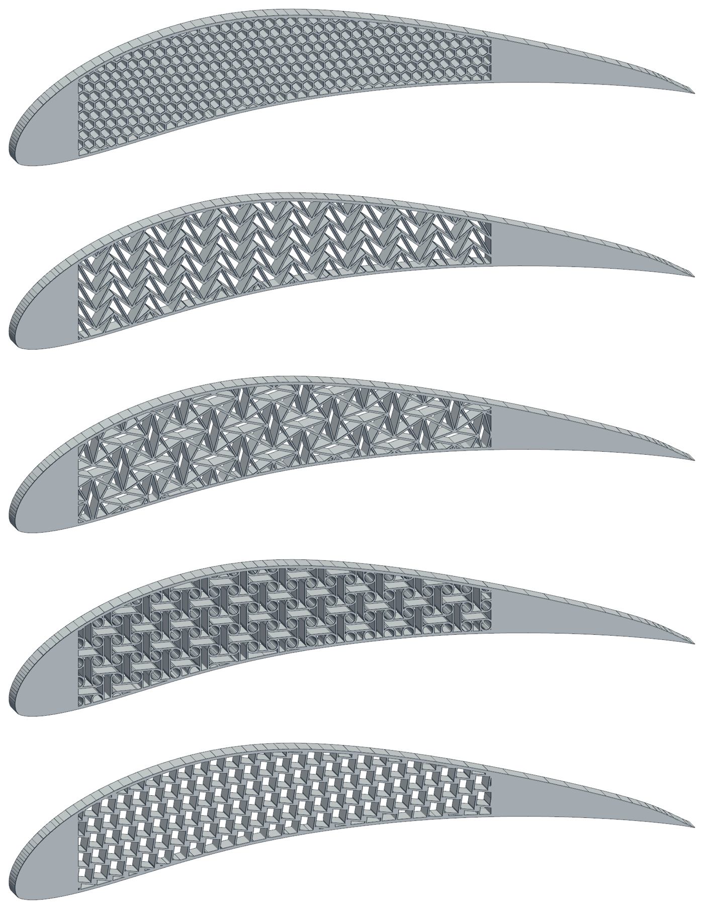
</p>
<p align="center"><sub>The five Stage 1 wing sections. From top: hexagonal (reference), double arrowhead, rotating squares, anti-tetrachiral, tetrachiral.</sub></p>

---

## Contents

1. [Summary](#summary)
2. [Motivation](#motivation)
3. [Research question and objectives](#research-question-and-objectives)
4. [Research gap](#research-gap)
5. [Background](#background)
6. [Methodology](#methodology)
7. [Results so far (Stage 1)](#results-so-far-stage-1)
8. [Next steps](#next-steps)
9. [Repository contents](#repository-contents)
10. [References](#references)

---

## Summary

A morphing wing changes its camber smoothly, without hinged flaps. Its internal core has to be stiff enough to hold the wing’s shape and flexible enough to let it bend. This project tests whether **auxetic lattices**, structures that get wider when stretched (a negative Poisson’s ratio), make a better morphing core than an ordinary honeycomb.

The comparison is kept fair. All cores sit inside the **same Eppler 420 wing** with the same skin, nose, tail and pocket, and every core uses **the same amount of material**. Only the cell shape changes.

| Stage | Work | Status |
|---|---|---|
| 1 | Wing geometry and five lattice cores, modelled parametrically in SolidWorks | ✅ complete |
| 2 | 2-D plane-stress FEA in ANSYS: lattice properties, wing bending, vibration, impact | ⏳ next |
| 3 | Aerodynamics of the deformed shapes; 3-D printed TPU test pieces | 🔜 planned |

> No simulation results exist yet. The only results reported here are geometric (design and volume checks).

---

## Motivation

Flaps and ailerons leave gaps and sharp corners in the airflow, which add drag and noise. A morphing wing does the same job by bending smoothly. The difficulty is that one structure must meet two opposing demands:

- **stiff enough** to keep its shape under aerodynamic load, and
- **compliant enough** to change shape when the actuator moves it, without a large force or overstraining the material.

This conflict is settled in the **core** between the upper and lower skins. A solid core is too stiff to morph, and an empty wing cannot hold its profile. A lattice core sits in between, and its cell geometry decides how it bends [1, 2].

Ordinary honeycombs get narrower when stretched, so in a curved, skinned section they resist bending. Auxetic lattices do the opposite [3, 4]. They also resist indentation better, absorb impact energy well and curve naturally into dome shapes [4, 5]. All of these properties are useful in a wing that must bend smoothly and survive hail or bird strikes.

My undergraduate thesis (team of three, IUT) studied the double arrowhead auxetic lattice for impact protection. This project takes that lattice, along with other auxetic families, into a morphing wing.

---

## Research question and objectives

**Research question.** When the core of a camber-morphing airfoil is switched between a hexagonal reference and several auxetic lattices *at equal solid fraction*, which lattice gives the largest trailing-edge deflection per unit actuation force, and at what peak strain? How do the same cores compare in vibration and impact?

**Objectives**

- [x] **O1.** Build an accurate Eppler 420 wing section in SolidWorks, with a core pocket that can hold any lattice and dimensions that are all editable global variables.
- [x] **O2.** Design five cores with the same wall thickness and the same solid fraction: a hexagonal reference plus double arrowhead, rotating squares, anti-tetrachiral and tetrachiral.
- [ ] **O2b.** Redraw the star-shaped core from my first model to the same rules, so that it joins the comparison.
- [ ] **O3.** Find each lattice’s effective Poisson’s ratio and stiffness with 2-D plane-stress FEA in ANSYS, and check the hexagonal result against Gibson–Ashby theory.
- [ ] **O4.** Compare how each wing bends under actuation: trailing-edge deflection per unit force, peak strain against a 5% limit, and smoothness of the deformed shape.
- [ ] **O5.** Compare vibration behaviour with modal and harmonic analyses.
- [ ] **O6.** Compare impact response (peak force, energy absorbed) with an explicit dynamics analysis.
- [ ] **O7.** 3-D print the most promising cores in TPU and test them on a bench to check the simulations.

---

## Research gap

Auxetic and chiral cores have been proposed for morphing airfoils for about twenty years [6–9]. Three things still make it hard to choose one:

1. **Studies cover one lattice at a time.** Each paper uses its own airfoil, size, material and relative density. A lattice’s stiffness depends very strongly on how much material it contains (roughly on the cube of relative density for a bending-dominated honeycomb [10]), so results from different papers cannot be compared directly.
2. **Some auxetic families are rarely tried in wings.** Double arrowhead and rotating-squares lattices are well studied for impact and as auxetic mechanisms [11–13], but they appear far less often as morphing-wing cores than chiral honeycombs do.
3. **Static, vibration and impact behaviour are studied separately.** It is not clear whether the core that bends most easily also vibrates least or absorbs impact best.

**This project:** a like-for-like comparison of several auxetic families inside the same airfoil, at the same solid fraction, in the same printable material (TPU), covering static morphing, vibration and impact.

---

## Background

| Lattice | How it becomes auxetic | Key reference |
|---|---|---|
| Hexagonal (reference) | Not auxetic; in-plane Poisson’s ratio ≈ +1 | Gibson & Ashby [10] |
| Double arrowhead | Nested chevrons fold together under load | Larsen et al. [11]; Qiao & Chen [12] |
| Rotating squares | Rigid squares rotate at their corners; ideal ν = −1 | Grima & Evans [13] |
| Anti-tetrachiral / tetrachiral | Nodes rotate, ligaments wrap around them; 4-connected versions are direction dependent | Prall & Lakes [14]; Alderson et al. [15] |
| Star (my first model) | Re-entrant star cells joined by chiral-type links; a cell shape tuned for FDM printing, not a new lattice class | — |

**Earlier morphing-airfoil studies:**
- Bornengo et al. [6] used a hexagonal chiral core to give large camber changes at low strain.
- Spadoni & Ruzzene [7] measured the static compliance of chiral truss-core airfoils, numerically and experimentally.
- Bettini et al. [8] developed a manufacturing process for composite chiral morphing airfoils.
- Budarapu et al. [9] studied an aluminium auxetic-core airfoil and matched its compliance to published experiments.
- Olympio & Gandhi [2] showed that a core which does not need to contract sideways avoids the stiffening that conventional honeycombs suffer when the skins restrain them.

---

## Methodology

### Wing geometry

| Parameter | Value |
|---|---|
| Airfoil | Eppler 420 (UIUC Airfoil Coordinates Database [16]) |
| Max. thickness / camber | 14.3% at 22.8% chord / 10.6% at 40.5% chord |
| Chord | 700 mm, leading edge at the origin |
| Section (span) thickness | 20 mm |
| Skin | uniform 2.5 mm |
| Core pocket | x = 65 to 490 mm (≈ 9–70% chord) |
| Nose / tail | solid; nose clamped (spar), tail actuated |

<p align="center">
  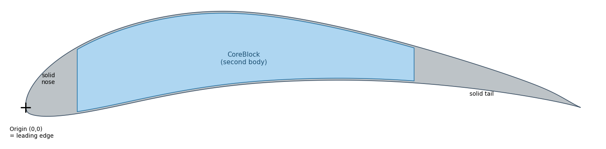
</p>
<p align="center"><sub>Wing layout. The pocket (blue) is a separate body, <i>CoreBlock</i>, which is filled with the lattice.</sub></p>

### Core design rules

Every core follows the same three rules, so that **only the cell shape changes**:

1. **1.5 mm walls.** This is just under four nozzle widths for a 0.4 mm FDM nozzle, so the walls print reliably in TPU.
2. **Solid fraction 0.25.** A quarter of the pocket is material.
3. **Identical skin, nose, tail and pocket.**

| Core | Driving dimensions (mm) | Repeat unit (mm) | Expected ν (idealised) |
|---|---|---|---|
| Hexagonal (reference) | wall *l* = 6.5, angle 30° | 11.26 × 19.5 | ≈ +1 |
| Double arrowhead | *W* = 37, *H1* = 0.9*W*, *H2* = 0.4*W* | 37 × 18.5 | negative |
| Rotating squares (braced) | pitch *p* = 31, rotation 15° | 62 × 62 | negative (ideal −1) |
| Anti-tetrachiral | pitch *P* = 20, ring radius *R* = 6 | 40 × 40 | negative |
| Tetrachiral | pitch *P* = 16.5, node radius 0.15*P*, lattice turned 8° | 16.5 × 16.5 | negative, direction dependent |

### Modelling in SolidWorks

- **Parametric.** Global variables (`span = 20`, `t_skin = 2.5`, `t = 1.5`, `x_front = 65`, `x_rear = 490`, plus the cell dimensions) drive every feature, so changing one value rebuilds the lattice.
- **Wing body.** The airfoil curves come in through *Curve Through XYZ Points* and are extruded into the solid wing. A second sketch, offset inwards by the skin thickness and closed at x = 65 and 490 mm, is used twice: once to cut the pocket and once to create the CoreBlock body.
- **Lattices, two methods:**
  - *Cutting holes* (hexagonal, double arrowhead, rotating squares): sketch the holes of one repeat unit, cut them into the CoreBlock only (*Feature Scope*), then repeat with a two-direction *Linear Pattern*.
  - *Building walls* (anti-tetrachiral, tetrachiral): extrude the rings or nodes and ligaments of one unit as new bodies, pattern them, then trim to the pocket with *Combine → Common*.
- **Finish.** *Combine → Add* joins the lattice to the wing, giving one solid body per wing. *Mass Properties* is used to check the volumes.

### Planned analyses (Stages 2–3)

**Material:** TPU 95A, linear elastic for a first pass. E ≈ 26 MPa, ν = 0.45, ρ = 1210 kg/m³, 5% allowable strain. These values will be replaced by measurements from my own printed specimens.

| Step | Analysis | Outputs |
|---|---|---|
| 2a | **Lattice coupons**: 2-D plane-stress FEA in ANSYS on about 5 × 5 repeat units, stretched by 1%; two mesh densities | Effective Poisson’s ratio and stiffness; hexagonal check against ν ≈ +1 |
| 2b | **Wing bending**: nose clamped; tail moved by a pushrod or a slotted rocker (bolts free to slide along the chord) | Force per mm of trailing-edge deflection, peak strain, shape smoothness |
| 2c | **Vibration**: modal and harmonic response | Natural frequencies, mode shapes, amplitude at equal damping ratio |
| 2d | **Impact**: explicit dynamics, rigid impactor on a coupon and on the leading edge | Peak force, energy absorbed |
| 3 | **Aerodynamics and tests**: XFOIL [17] and my MATLAB panel-method code; TPU prints | Change in lift and drag; measured ν, deflection, free-decay damping |

> **Note on damping.** In a linear model, damping is an input, so a simulation alone cannot show that one lattice damps better than another. Any damping claim will come from the free-decay test on printed parts.

---

## Results so far (Stage 1)

### 1. Airfoil check
The scaled profile matches the published Eppler 420 data: 14.3% thickness at 22.8% chord and 10.6% camber at 40.5% chord [16, 18]. My earlier model’s chord measured 700.07 mm, so the 700 mm chord was kept.

### 2. First attempt: the star-shaped core (May 2025)

<p align="center">
  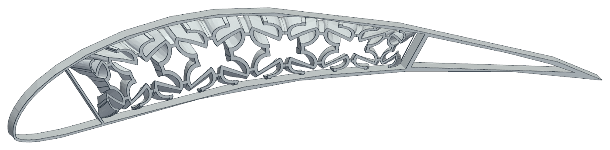
</p>
<p align="center"><sub>My first Eppler 420 model (SolidWorks), with star-shaped chiral blocks inside a hollow skin.</sub></p>

The outline was correct, but the skin was not uniform: about 2.5 mm thick at the front and about 4.6 mm at the rear. Comparing cores inside this wing would have mixed the effect of the lattice with the effect of the skin. **This lesson led to the redesign:** a uniform skin, a fixed pocket and equal-material cores. The star core will be redrawn inside the new wing to the same rules.

### 3. The five wings

| Core | Whole section | Core close-up |
|---|---|---|
| **Hexagonal** (reference) | 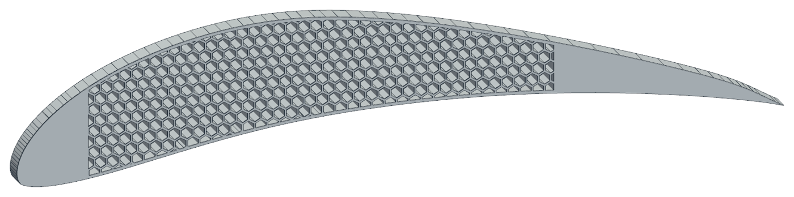 | 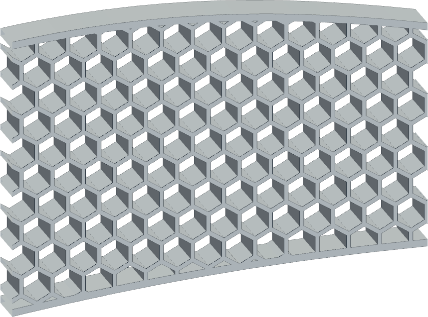 |
| **Double arrowhead** | 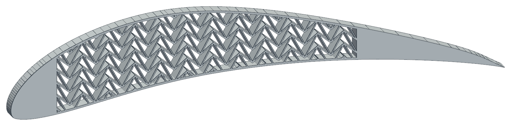 | 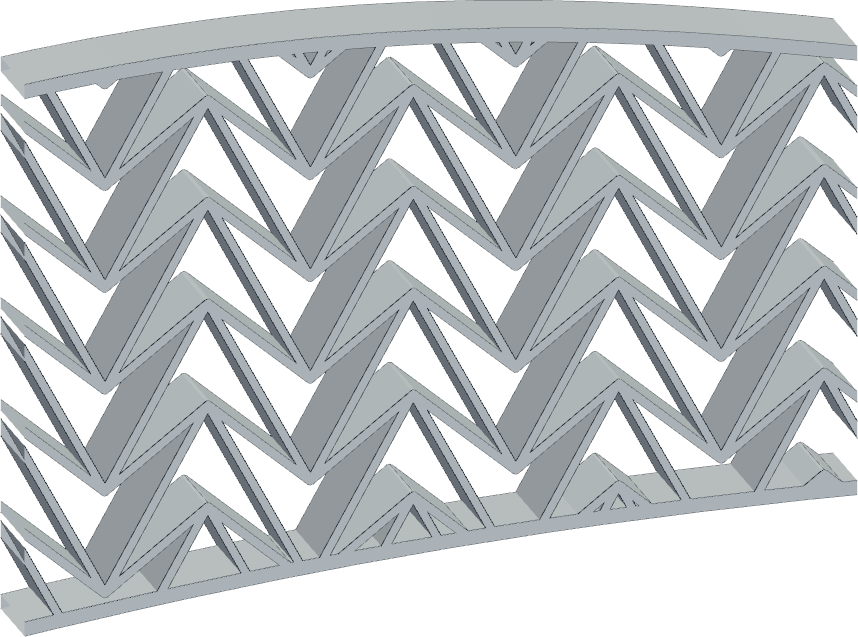 |
| **Rotating squares** | 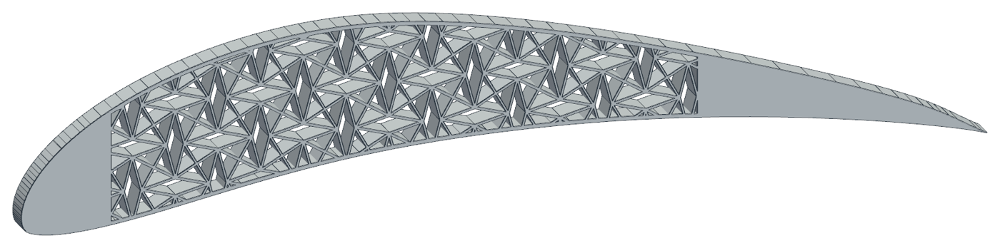 | 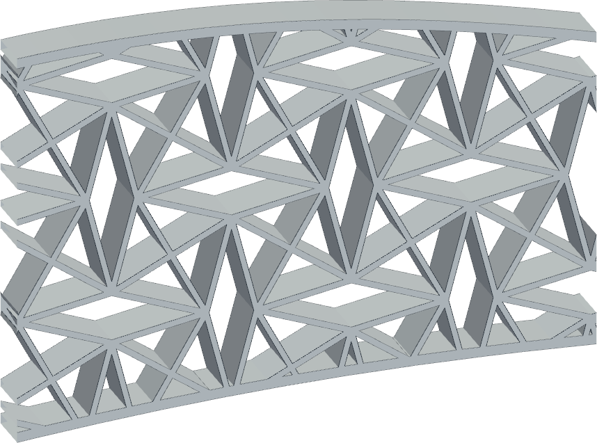 |
| **Anti-tetrachiral** | 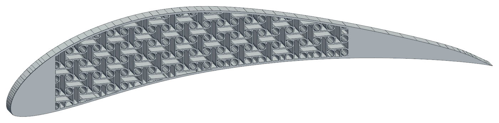 | 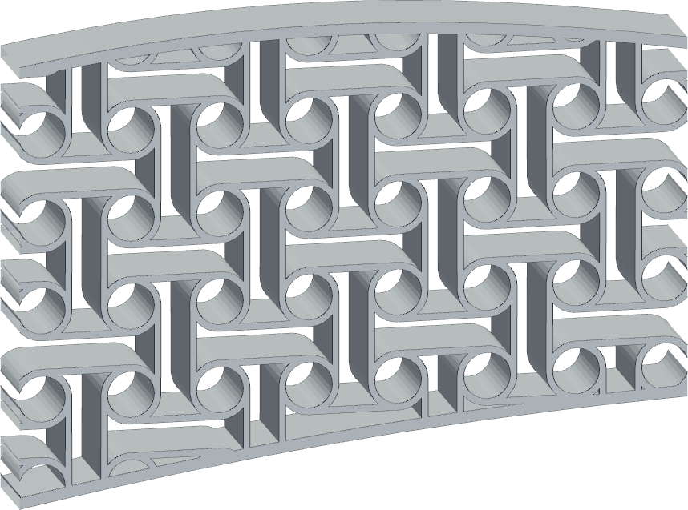 |
| **Tetrachiral** (turned 8°) | 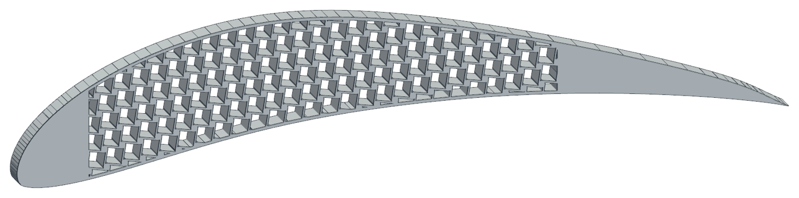 | 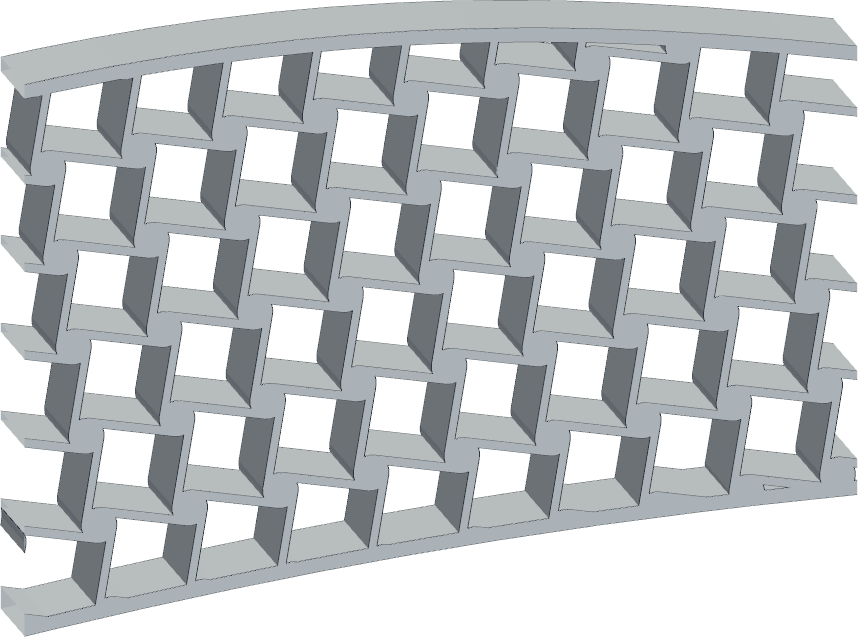 |

### 4. Equal material in every wing

Volumes come from SolidWorks *Mass Properties* for the 20 mm section.
- **Lattice volume** = finished wing − wing with empty pocket.
- **Solid fraction** = lattice volume ÷ CoreBlock volume (662,511 mm³).
- **Mass** assumes TPU at 1.21 g/cm³.

| Model | Volume (mm³) | Lattice volume (mm³) | Core solid fraction | Mass in TPU (g) |
|---|---:|---:|---:|---:|
| Solid wing (no pocket) | 889,792 | – | – | 1,077 |
| Wing with empty pocket | 227,281 | – | – | 275 |
| Hexagonal | 392,145 | 164,864 | 0.249 | 474 |
| Double arrowhead | 393,573 | 166,292 | 0.251 | 476 |
| Rotating squares | 395,459 | 168,178 | 0.254 | 479 |
| Anti-tetrachiral | 390,502 | 163,221 | 0.246 | 473 |
| Tetrachiral | 391,332 | 164,051 | 0.248 | 474 |

**The five wings differ by only 1.27% in volume, and their core solid fractions lie between 0.246 and 0.254.** Any difference in Stage 2 can therefore be traced to the cell shape, not to the amount of material.

---

## Next steps

| # | Task | Output | Timing |
|---|---|---|---|
| 1 | Publish Stage 1 models (this repository) | SolidWorks parts, STEP files | 
| 2 | Redraw the star core at solid fraction 0.25 | Sixth wing, volume check | 
| 3 | Stage 2a: lattice coupons | ν and stiffness of each core |
| 4 | Stage 2b: wing bending | Force/deflection, peak strain |
| 5 | Stage 2c: modal and harmonic | Frequencies, amplitudes |
| 6 | Stage 2d: impact | Peak force, energy absorbed | 
| 7 | Stage 3: aerodynamics tests | Lift/drag change; measured data | 
| 8 | Write-up | Report and paper draft | 

**Limitations.**
- The 2-D plane-stress model ignores effects along the span.
- Material values are from datasheets until I test my own printed specimens.
- The study covers one airfoil, one wall thickness and one solid fraction, so its ranking will not be claimed for every wing.

**Beyond this project:**
- graded cells along the chord;
- full 3-D wings;
- topology-optimised cores for a target camber change;
- fatigue under repeated morphing.

---

## Repository contents

```
eppler420-auxetic-wing-cores/
├── README.md
├── images/        figures used in this README
├── wings/         the five wings (.SLDPRT and .STEP) and my first star-core wing
├── unit_cells/    one repeat unit of each core (.SLDPRT and .STEP)
└── data/
    ├── eppler420_upper_700mm.txt   Eppler 420 upper surface, scaled to 700 mm (x, y, z in mm)
    ├── eppler420_lower_700mm.txt   Eppler 420 lower surface, scaled to 700 mm
    └── check_volumes_mm3.json      volumes from SolidWorks Mass Properties
```


---

## References

1. S. Barbarino, O. Bilgen, R. M. Ajaj, M. I. Friswell, D. J. Inman, *A review of morphing aircraft*, J. Intell. Mater. Syst. Struct. 22(9) (2011) 823–877.
2. K. R. Olympio, F. Gandhi, *Zero Poisson’s ratio cellular honeycombs for flex skins undergoing one-dimensional morphing*, J. Intell. Mater. Syst. Struct. 21(17) (2010) 1737–1753.
3. R. Lakes, *Foam structures with a negative Poisson’s ratio*, Science 235 (1987) 1038–1040.
4. K. E. Evans, A. Alderson, *Auxetic materials: functional materials and structures from lateral thinking!*, Adv. Mater. 12(9) (2000) 617–628.
5. H. M. A. Kolken, A. A. Zadpoor, *Auxetic mechanical metamaterials*, RSC Adv. 7 (2017) 5111–5129.
6. D. Bornengo, F. Scarpa, C. Remillat, *Evaluation of hexagonal chiral structure for morphing airfoil concept*, Proc. IMechE Part G 219(3) (2005) 185–192.
7. A. Spadoni, M. Ruzzene, *Numerical and experimental analysis of the static compliance of chiral truss-core airfoils*, J. Mech. Mater. Struct. 2(5) (2007) 965–981.
8. P. Bettini, A. Airoldi, G. Sala, L. Di Landro, M. Ruzzene, A. Spadoni, *Composite chiral structures for morphing airfoils: numerical analyses and development of a manufacturing process*, Compos. Part B 41(2) (2010) 133–147.
9. P. R. Budarapu, Y. B. Sudhir Sastry, R. Natarajan, *Design concepts of an aircraft wing: composite and morphing airfoil with auxetic structures*, Front. Struct. Civ. Eng. 10(4) (2016) 394–408.
10. L. J. Gibson, M. F. Ashby, *Cellular Solids: Structure and Properties*, 2nd ed., Cambridge University Press, 1997.
11. U. D. Larsen, O. Sigmund, S. Bouwstra, *Design and fabrication of compliant micromechanisms and structures with negative Poisson’s ratio*, J. Microelectromech. Syst. 6(2) (1997) 99–106.
12. J. X. Qiao, C. Q. Chen, *Impact resistance of uniform and functionally graded auxetic double arrowhead honeycombs*, Int. J. Impact Eng. 83 (2015) 47–58.
13. J. N. Grima, K. E. Evans, *Auxetic behavior from rotating squares*, J. Mater. Sci. Lett. 19 (2000) 1563–1565.
14. D. Prall, R. S. Lakes, *Properties of a chiral honeycomb with a Poisson’s ratio of −1*, Int. J. Mech. Sci. 39(3) (1997) 305–314.
15. A. Alderson et al., *Elastic constants of 3-, 4- and 6-connected chiral and anti-chiral honeycombs subject to uniaxial in-plane loading*, Compos. Sci. Technol. 70(7) (2010) 1042–1048.
16. M. S. Selig, *UIUC Airfoil Coordinates Database*, University of Illinois Urbana-Champaign. <https://m-selig.ae.illinois.edu/ads/coord_database.html>
17. M. Drela, *XFOIL: An analysis and design system for low Reynolds number airfoils*, in: Low Reynolds Number Aerodynamics, Lecture Notes in Engineering 54, Springer, 1989, 1–12.
18. R. Eppler, *Airfoil Design and Data*, Springer, 1990.

---

<sub>© 2026 Zahin Tasnim Ridita. 
